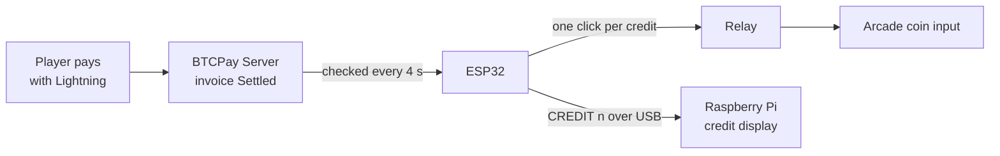

# Bitcoin Switch – ESP32 + BTCPay Server

ESP32 firmware that turns paid Lightning invoices into arcade credits. When a player pays through BTCPay Server, the ESP32 clicks a relay on the arcade's coin input, once per credit.

Built for the [Bitcoin Ekasi](https://bitcoinekasi.com) arcade machine.



## Features

- **Pays out once.** Each paid invoice is saved to flash before the relay clicks, so a reboot or power cut can never pay the same invoice out twice.
- **Catches up after drop-outs.** Payments made while Wi-Fi was down for under an hour are still credited when it reconnects.
- **Skips old invoices.** On its very first start, it ignores invoices that were already paid.
- **Credits by amount.** For example, R15 at R5 per credit gives 3 coins.
- **Talks to the Pi.** It reports credits and status over USB serial, for an optional Raspberry Pi display.
- **Simple setup.** No LNbits, no captive portal. It needs only one library, ArduinoJson.

## Repository layout

```
bitcoin_switch/
  bitcoin_switch.ino   ← the firmware (Arduino needs the folder and file to share a name)
README.md
```

## What you need

| Item | Details |
| --- | --- |
| ESP32 dev board | Any ESP32 DevKit (Node32s or ESP32 Dev Module in Arduino IDE) |
| Relay module | 1 channel, 5 V |
| Arduino IDE | 1.8.19 or 2.x |
| ESP32 board package | ESP32 Arduino core 2.0.14 (Boards Manager) |
| Library | [ArduinoJson](https://arduinojson.org) 7.x by Benoit Blanchon (Library Manager) |
| BTCPay Server | A store with Lightning enabled |

## Setup

### 1. BTCPay Server

1. Create a store for the arcade, with Lightning enabled. Turn off on-chain payments, because confirmations are too slow for a game.
2. Add a **Point of Sale** app with one item, for example "1 Credit" at R5.00. Players scan its link.
3. Go to **Account → API Keys → Generate Key**. Tick only **View invoices** for that store.
4. Copy the **Store ID** from Store Settings → General.

### 2. Configure the sketch

Open `bitcoin_switch/bitcoin_switch.ino` and fill in the settings block at the top:

| Setting | What to put |
| --- | --- |
| `WIFI_SSID`, `WIFI_PASSWORD` | Your Wi-Fi name and password |
| `BTCPAY_URL` | Your server address, e.g. `https://btcpay.example.com` (no slash at the end) |
| `STORE_ID` | Your store ID |
| `API_KEY` | The View invoices key |
| `CREDIT_PRICE` | Price of one credit in the store currency, e.g. `5.00`. Use `0` for 1 credit per invoice. |
| `ORDER_ID_FILTER` | Optional: `pos-app_<APP_ID>` to count only one Point of Sale app |
| `RELAY_PIN` | GPIO wired to relay IN (default 13) |
| `RELAY_ACTIVE_LOW` | `true` if your relay switches on when IN is LOW |
| `PULSE_MS`, `PULSE_GAP_MS` | Length of each coin pulse and the pause between them |

> **Don't commit your real Wi-Fi password or API key.** Keep the placeholders in the repo, and fill them in only on your own computer before uploading to the board.

### 3. Upload

1. Sketch → Include Library → Manage Libraries → install **ArduinoJson 7.x**.
2. Tools → Board → **Node32s** (or ESP32 Dev Module), then pick the COM port.
3. Click **Upload**.

If the upload fails with `Failed to connect… waiting for packet header`, hold the **BOOT** button while it says "Connecting…". If that doesn't fix it, set Tools → Upload Speed to 115200 and use a USB cable that carries data.

## Wiring

| From | To | Note |
| --- | --- | --- |
| ESP32 GPIO 13 | Relay IN | Avoid GPIO 0, 2, 12 and 15 |
| ESP32 VIN (5 V) | Relay VCC | |
| ESP32 GND | Relay GND | |
| Relay COM + NO | Arcade coin input (2 wires) | In parallel with the coin button or acceptor |
| ESP32 USB | Raspberry Pi USB | Power and messages to the credit display (optional) |

## Testing

Open the Serial Monitor at **115200 baud**. You should see `WIFI OK <ip>`, then `HB OK` every 5 seconds. Type `TEST` and press Enter: the relay clicks once.

### Serial messages

| Message | Meaning |
| --- | --- |
| `BOOT bitcoin_switch 1.0 (BTCPay)` | Firmware started |
| `WIFI OK <ip>` / `WIFI DOWN` | Wi-Fi connected or lost |
| `HB OK` / `HB NOWIFI` / `HB NOTIME` / `HB APIERR` | Heartbeat every 5 s: online, no Wi-Fi, clock not synced yet, or can't reach BTCPay |
| `CREDIT <n> <invoiceId>` | n credits were paid. The relay clicks n times. |
| `INFO …` / `ERR …` | Extra detail, such as why BTCPay refused a request |

Commands it accepts: `TEST` clicks the relay once and replies `CREDIT 1 TEST`.

## Troubleshooting

| Problem | Fix |
| --- | --- |
| `ERR BTCPay replied 401` (or 403, 404) | Wrong `STORE_ID`, or the API key lacks **View invoices** |
| Relay stays on at boot, or clicks the wrong way round | Set `RELAY_ACTIVE_LOW = true` |
| Game misses some coins | Set `PULSE_MS = 150` and `PULSE_GAP_MS = 400` |
| `HB NOTIME` for over a minute | The network is blocking internet time servers (NTP) |
| Compile error about ArduinoJson | Update ArduinoJson to version 7.x |

## How it works

Every 4 seconds the ESP32 asks the BTCPay Greenfield API for invoices with status `Settled` from the last hour. It requests `GET /api/v1/stores/{storeId}/invoices?status=Settled&startDate=…`.

For each invoice it hasn't seen before, it does three things in order:

1. Works out the credits from the paid amount.
2. Saves a hash of the invoice ID to flash. It does this first, so a reboot can't cause a double pay-out.
3. Pulses the relay once per credit.

It remembers the last 200 invoices. HTTPS is used, but the server certificate isn't checked unless you paste your server's root CA into `ROOT_CA`.
